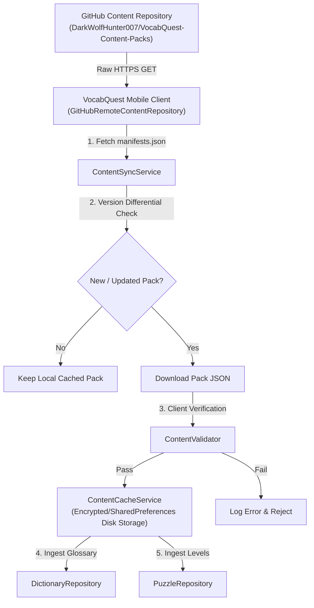
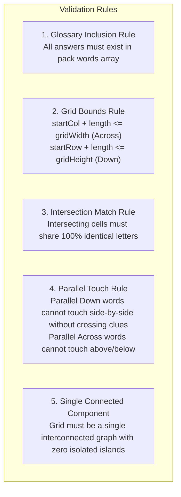

# 🛠️ VocabQuest Content Pack Authoring & Build Guide

> **Authoritative Engineering Manual** for building, validating, packaging, and deploying Over-The-Air (OTA) expansion packs for **VocabQuest** (`com.darkwolfhunter007.mey.vocabquest`).

---

## 📑 Table of Contents

1. [Architecture & OTA Pipeline](#1-architecture--ota-pipeline)
2. [Repository Directory Topology](#2-repository-directory-topology)
3. [Complete JSON Schema Specifications](#3-complete-json-schema-specifications)
   - [3.1 Manifest Catalog Schema (`manifests.json`)](#31-manifest-catalog-schema-manifestsjson)
   - [3.2 Pack Root Metadata Schema](#32-pack-root-metadata-schema)
   - [3.3 Dictionary Words Schema (`words`)](#33-dictionary-words-schema-words)
   - [3.4 Crossword Puzzles Schema (`crosswordPuzzles`)](#34-crossword-puzzles-schema-crosswordpuzzles)
   - [3.5 Word Search Puzzles Schema (`wordSearchPuzzles`)](#35-word-search-puzzles-schema-wordsearchpuzzles)
4. [Cruciverbalist Construction Rules & Layout Physics](#4-cruciverbalist-construction-rules--layout-physics)
5. [Step-by-Step Expansion Pack Creation Tutorial](#5-step-by-step-expansion-pack-creation-tutorial)
   - [Step 1: Create the Pack JSON](#step-1-create-the-pack-json)
   - [Step 2: Calculate Byte Size](#step-2-calculate-byte-size)
   - [Step 3: Register in Manifest Catalogs](#step-3-register-in-manifest-catalogs)
   - [Step 4: Test & Validate Offline](#step-4-test--validate-offline)
   - [Step 5: Publish via Git](#step-5-publish-via-git)
6. [Complete Production Boilerplate (`pack_history_v1.json`)](#6-complete-production-boilerplate-pack_history_v1json)
7. [Version Bumping & OTA Lifecycle Management](#7-version-bumping--ota-lifecycle-management)
8. [Player Acquisition & Store Monetization UX](#8-player-acquisition--store-monetization-ux)
9. [Pre-Flight Validation Checklist](#9-pre-flight-validation-checklist)

---

## 1. Architecture & OTA Pipeline

VocabQuest features an offline-first, Over-The-Air (OTA) dynamic content distribution engine. Players can discover, download, and unlock new vocabulary expansion packs without requiring an app update through the Google Play Store.

### 🌐 OTA Data Flow



### 🎯 Remote Repository Resolution Sequence

When querying packs, the mobile client executes an optimized HTTP request cascade:

1. **Manifest Catalog Probe**:
   - Primary: `https://raw.githubusercontent.com/DarkWolfHunter007/VocabQuest-Content-Packs/main/content/manifests.json`
   - Fallback: `https://raw.githubusercontent.com/DarkWolfHunter007/VocabQuest-Content-Packs/main/manifests.json`

2. **Pack Download Candidate Probe**:
   - `https://raw.githubusercontent.com/DarkWolfHunter007/VocabQuest-Content-Packs/main/content/packs/{pack_id}.json`
   - `https://raw.githubusercontent.com/DarkWolfHunter007/VocabQuest-Content-Packs/main/content/packs/{pack_id}_v{version}.json`
   - `https://raw.githubusercontent.com/DarkWolfHunter007/VocabQuest-Content-Packs/main/content/packs/{pack_id}/v{version}.json`

---

## 2. Repository Directory Topology

All expansion packs and manifests live in the `DarkWolfHunter007/VocabQuest-Content-Packs` repository with the following structure:

```tree
VocabQuest-Content-Packs/
├── .git/
├── README.md                      # General repository documentation
├── BUILD.md                       # This comprehensive authoring & build manual
├── app-ads.txt                    # AdMob authorized digital seller verification
├── manifests.json                 # Root fallback catalog (mirrors content/manifests.json)
└── content/
    ├── manifests.json             # Primary catalog fetched by mobile clients
    └── packs/
        ├── pack_science_v1.json   # Science & Technology Expansion Pack (v1)
        ├── pack_nature_v1.json    # Wild Wonders & Nature Expansion Pack (v1)
        ├── pack_space_v1.json     # Space & Astronomy Expansion Pack (v1)
        ├── pack_history_v1.json   # History & Civilizations Expansion Pack (v1)
        └── pack_<id>_v<version>.json
```

> [!IMPORTANT]
> Always maintain identical content in both `content/manifests.json` and root `manifests.json` to support seamless legacy and modern client resolution.

---

## 3. Complete JSON Schema Specifications

Every JSON file in the content pipeline strictly adheres to the VocabQuest Content Engine data contract.

---

### 3.1 Manifest Catalog Schema (`manifests.json`)

The manifest catalog is a root JSON array containing summary metadata for all published packs.

```json
[
  {
    "id": "pack_history_v1",
    "version": 1,
    "name": "History & Ancient Civilizations Pack",
    "description": "Dynasties, archaeological artifacts, empires, and ancient world discoveries.",
    "category": "History",
    "difficulty": "Medium",
    "wordCount": 6,
    "puzzleCount": 2,
    "minAppVersion": "1.0.0",
    "sizeBytes": 4580
  }
]
```

#### Manifest Field Specification Table

| Field | Type | Required | Description | Example / Constraints |
|---|---|:---:|---|---|
| `id` | `string` | **Yes** | Unique identifier for the expansion pack. Must be lowercase alphanumeric with underscores. | `"pack_history_v1"` |
| `version` | `integer` | **Yes** | Monotonically increasing schema/content version number ($\ge 1$). | `1`, `2` |
| `name` | `string` | **Yes** | Player-facing title displayed in the Store and Pack Catalog. | `"History & Ancient Civilizations Pack"` |
| `description` | `string` | **Yes** | One or two-sentence description summarizing pack theme. | `"Dynasties, artifacts, and empires."` |
| `category` | `string` | **Yes** | Categorization tag. Mapped to theme icons and accent colors. | `"History"`, `"Science"`, `"Space"`, `"Nature"`, `"Academic"`, `"Travel"` |
| `difficulty` | `string` | **Yes** | Overall pack difficulty tier. | `"Easy"`, `"Medium"`, `"Hard"`, `"All"` |
| `wordCount` | `integer` | **Yes** | Total number of vocabulary words in the `words` array. | `6` |
| `puzzleCount` | `integer` | **Yes** | Total count of crossword + word search puzzles ($N_{cw} + N_{ws}$). | `2` |
| `minAppVersion`| `string` | **Yes** | Minimum VocabQuest app version required to parse this pack. | `"1.0.0"` |
| `downloadUrl` | `string?` | *Optional*| Explicit download override URL (null by default; uses GitHub raw resolution). | `null` |
| `sizeBytes` | `integer` | **Yes** | Exact uncompressed byte size of the `.json` pack file on disk. | `4580` |

---

### 3.2 Pack Root Metadata Schema

Each pack file inside `content/packs/<pack_id>.json` contains the full glossary and puzzle layouts:

```json
{
  "id": "pack_history_v1",
  "version": 1,
  "name": "History & Ancient Civilizations Pack",
  "description": "Dynasties, archaeological artifacts, empires, and ancient world discoveries.",
  "category": "History",
  "difficulty": "Medium",
  "isBuiltIn": false,
  "minAppVersion": "1.0.0",
  "words": [ /* Array of Word objects */ ],
  "crosswordPuzzles": [ /* Array of CrosswordContent objects */ ],
  "wordSearchPuzzles": [ /* Array of WordSearchContent objects */ ]
}
```

| Field | Type | Default | Description |
|---|---|---|---|
| `id` | `string` | *Required* | Matches manifest `id`. |
| `version` | `integer` | `1` | Matches manifest `version`. |
| `name` | `string` | *Required* | Matches manifest `name`. |
| `description` | `string` | `""` | Matches manifest `description`. |
| `category` | `string` | `"General"` | Matches manifest `category`. |
| `difficulty` | `string` | `"All"` | Matches manifest `difficulty`. |
| `isBuiltIn` | `boolean` | `false` | Always set to `false` for downloadable expansion packs. |
| `minAppVersion`| `string` | `"1.0.0"` | Minimum client version supported. |
| `words` | `List<Word>`| `[]` | Glossary definitions and metadata. |
| `crosswordPuzzles` | `List<Crossword>`| `[]` | Array of crossword level layouts. |
| `wordSearchPuzzles`| `List<WordSearch>`| `[]` | Array of word search level layouts. |

---

### 3.3 Dictionary Words Schema (`words`)

Every word used across crosswords or word searches in this pack **must** be defined in the `words` array.

```json
{
  "id": "pharaoh",
  "word": "PHARAOH",
  "partOfSpeech": "n.",
  "phonetic": "/ˈfeə.roʊ/",
  "definition": "A monarch or supreme ruler of ancient Egypt.",
  "exampleSentence": "The ancient pharaoh oversaw the construction of monumental pyramids along the Nile.",
  "difficulty": "medium",
  "category": "History",
  "tags": ["egypt", "royalty", "ancient"]
}
```

#### Word Object Field Specification

- **`id`** (`string`, *required*): Unique slug for the word (typically lowercase letters without spaces).
- **`word`** (`string`, *required*): Uppercase alphabetic string (`^[A-Z]+$`), length between $2$ and $20$ letters. No spaces, dashes, or punctuation.
- **`partOfSpeech`** (`string`, *required*): Part of speech abbreviation (`"n."`, `"v."`, `"adj."`, `"adv."`, `"prep."`, `"conj."`).
- **`phonetic`** (`string`, *required*): International Phonetic Alphabet (IPA) pronunciation guide enclosed in slashes (e.g. `"/ˈfeə.roʊ/"`).
- **`definition`** (`string`, *required*): Clear, grammatically complete definition ($\ge 5$ characters).
- **`exampleSentence`** (`string`, *required*): High-quality contextual sentence using the exact word.
- **`difficulty`** (`string`, *required*): `"beginner"`, `"easy"`, `"medium"`, `"hard"`, or `"expert"`.
- **`category`** (`string`, *optional*): Category name (default: `"Everyday"`).
- **`tags`** (`List<string>`, *optional*): Searchable metadata keywords for dictionary indexing.

---

### 3.4 Crossword Puzzles Schema (`crosswordPuzzles`)

Each crossword level is defined by grid bounds, target completion time, and an array of clue entries.

```json
{
  "levelId": "history_cw_1",
  "levelNumber": 1,
  "title": "Nile Dynasties & Relics",
  "difficulty": "medium",
  "gridWidth": 8,
  "gridHeight": 8,
  "targetWords": [
    "PHARAOH",
    "EMPIRE",
    "TEMPLE",
    "DYNASTY",
    "RELIC"
  ],
  "clues": [
    {
      "number": 1,
      "direction": "across",
      "clue": "A supreme monarch of ancient Egypt who ruled over the Nile valley.",
      "answer": "PHARAOH",
      "startRow": 1,
      "startCol": 1
    },
    {
      "number": 1,
      "direction": "down",
      "clue": "A succession of rulers from the same ancestral family line.",
      "answer": "DYNASTY",
      "startRow": 1,
      "startCol": 1
    }
  ],
  "targetSecondsGoal": 75
}
```

#### Crossword Field Specifications

- **`levelId`** (`string`, *required*): Unique level identifier string (e.g., `"history_cw_1"`).
- **`levelNumber`** (`integer`, *required*): Sequence number within the pack ($1, 2, 3...$).
- **`title`** (`string`, *required*): Display title for the level header.
- **`difficulty`** (`string`, *required*): `"easy"`, `"medium"`, or `"hard"`.
- **`gridWidth`** (`integer`, *required*): Number of grid columns ($\ge 3$, typically $7$ to $10$).
- **`gridHeight`** (`integer`, *required*): Number of grid rows ($\ge 3$, typically $7$ to $10$).
- **`targetWords`** (`List<string>`, *required*): List of all solution words uppercase.
- **`clues`** (`List<CrosswordClueContent>`, *required*): List of clue layout definitions:
  - **`number`** (`integer`): Display clue number ($1, 2, 3...$). Clues starting at the same cell share the same number.
  - **`direction`** (`string`): Direction string, strictly `"across"` or `"down"`.
  - **`clue`** (`string`): Player-facing definition or riddle prompt.
  - **`answer`** (`string`): Target solution in uppercase letters.
  - **`startRow`** (`integer`): 0-indexed row position ($0 \le \text{startRow} < \text{gridHeight}$).
  - **`startCol`** (`integer`): 0-indexed column position ($0 \le \text{startCol} < \text{gridWidth}$).
- **`targetSecondsGoal`** (`integer`, *optional*): Par time in seconds for 3-star rating calculation (default: `60`s).

---

### 3.5 Word Search Puzzles Schema (`wordSearchPuzzles`)

Word search levels generate dynamic letter grids with randomized distractor letters and hidden words placed horizontally, vertically, or diagonally.

```json
{
  "levelId": "history_ws_1",
  "levelNumber": 1,
  "title": "Ancient Wonders & Artifacts",
  "difficulty": "medium",
  "gridSize": 10,
  "wordsToFind": [
    "PHARAOH",
    "EMPIRE",
    "TEMPLE",
    "DYNASTY",
    "RELIC",
    "ARCHIVE"
  ],
  "targetSecondsGoal": 90,
  "requiredCrosswordStars": 0
}
```

#### Word Search Field Specifications

- **`levelId`** (`string`, *required*): Unique word search level identifier (e.g., `"history_ws_1"`).
- **`levelNumber`** (`integer`, *required*): Sequence number within the pack ($1, 2, 3...$).
- **`title`** (`string`, *required*): Display title for the level header.
- **`difficulty`** (`string`, *required*): `"easy"`, `"medium"`, or `"hard"`.
- **`gridSize`** (`integer`, *required*): Grid dimension $N \times N$ ($4 \le \text{gridSize} \le 25$, standard is $10$ or $12$).
- **`wordsToFind`** (`List<string>`, *required*): List of words to locate. All words must have length $\le \text{gridSize}$ and exist in the `words` glossary.
- **`targetSecondsGoal`** (`integer`, *optional*): Par time in seconds (default: `90`s).
- **`requiredCrosswordStars`** (`integer`, *optional*): Number of crossword stars needed before this puzzle unlocks (default: `0` for expansion packs).

---

## 4. Cruciverbalist Construction Rules & Layout Physics

To ensure professional quality, all crossword layouts must adhere to standard cruciverbalist construction standards enforced by `ContentValidator`:



### Rule 1: Glossary Inclusion
Every clue answer in `crosswordPuzzles[].clues` and every target word in `wordSearchPuzzles[].wordsToFind` **must** have a corresponding entry in the pack's `words` array.

### Rule 2: Grid Boundary Invariance
- For an `across` clue:
  $$\text{startCol} + \text{length}(\text{answer}) \le \text{gridWidth}$$
- For a `down` clue:
  $$\text{startRow} + \text{length}(\text{answer}) \le \text{gridHeight}$$
- All coordinate positions are 0-indexed ($0 \le \text{startRow} < \text{gridHeight}$, $0 \le \text{startCol} < \text{gridWidth}$).

### Rule 3: Intersection Collision Matching
When an Across clue intersects a Down clue at grid cell $(R, C)$:
$$\text{AcrossWord}[C - \text{startCol}_{\text{across}}] == \text{DownWord}[R - \text{startRow}_{\text{down}}]$$
Any character discrepancy triggers an immediate validation failure on client download.

### Rule 4: No Unclued Parallel Touches (NYT Standard)
- Two parallel Across words cannot be placed in adjacent rows ($R$ and $R+1$) sharing overlapping column spans unless linked by valid intersecting Down words at every overlapping column.
- Two parallel Down words cannot be placed in adjacent columns ($C$ and $C+1$) sharing overlapping row spans unless linked by valid intersecting Across words.

### Rule 5: Single Connected Component
All words in a crossword grid must form one contiguous, intersecting topological graph. Floating, disconnected words ("islands") are disallowed.

### Rule 6: Content Safety & Profanity Filtering
Any word matching the profanity or inappropriate lexicon blocklist is automatically rejected during validation.

---

## 5. Step-by-Step Expansion Pack Creation Tutorial

Follow this 5-step walkthrough to build, verify, and publish a new expansion pack.

### Step 1: Create the Pack JSON
Create a new file in `content/packs/pack_<category>_v<version>.json` (e.g. `content/packs/pack_history_v1.json`).

### Step 2: Calculate Byte Size
Calculate the exact uncompressed byte length of the file:

**In PowerShell (Windows):**
```powershell
(Get-Item content/packs/pack_history_v1.json).Length
```

**In Bash (macOS / Linux):**
```bash
wc -c < content/packs/pack_history_v1.json
```

*Example Output:* `4580`

### Step 3: Register in Manifest Catalogs
Add the pack definition entry to **both** `content/manifests.json` and root `manifests.json`:

```json
{
  "id": "pack_history_v1",
  "version": 1,
  "name": "History & Ancient Civilizations Pack",
  "description": "Dynasties, archaeological artifacts, empires, and ancient world discoveries.",
  "category": "History",
  "difficulty": "Medium",
  "wordCount": 6,
  "puzzleCount": 2,
  "minAppVersion": "1.0.0",
  "sizeBytes": 4580
}
```

### Step 4: Test & Validate Offline
In the VocabQuest project workspace, run the automated test suite to verify schema parsing and validation:

```bash
flutter test test/architecture_upgrade_test.dart
```

### Step 5: Publish via Git
Commit the new files and push to the `main` branch of `DarkWolfHunter007/VocabQuest-Content-Packs`:

```bash
cd D:\Game-Build\VocabQuest-Content-Packs
git status
git add manifests.json content/manifests.json content/packs/pack_history_v1.json
git commit -m "feat(content): add History & Ancient Civilizations expansion pack v1"
git push origin main
```

Within seconds of the push, players launching or refreshing the Expansion Packs screen will see the new pack available for download!

---

## 6. Complete Production Boilerplate (`pack_history_v1.json`)

Here is a 100% compliant, fully tested, copy-paste ready boilerplate pack:

```json
{
  "id": "pack_history_v1",
  "version": 1,
  "name": "History & Ancient Civilizations Pack",
  "description": "Dynasties, archaeological artifacts, empires, and ancient world discoveries.",
  "category": "History",
  "difficulty": "Medium",
  "isBuiltIn": false,
  "minAppVersion": "1.0.0",
  "words": [
    {
      "id": "pharaoh",
      "word": "PHARAOH",
      "partOfSpeech": "n.",
      "phonetic": "/ˈfeə.roʊ/",
      "definition": "A monarch or supreme ruler of ancient Egypt.",
      "exampleSentence": "The pharaoh commanded the creation of grand stone temples along the river.",
      "difficulty": "medium",
      "category": "History",
      "tags": ["egypt", "ancient", "monarch"]
    },
    {
      "id": "empire",
      "word": "EMPIRE",
      "partOfSpeech": "n.",
      "phonetic": "/ˈɛm.paɪ.ər/",
      "definition": "An extensive group of states or countries under a single supreme authority.",
      "exampleSentence": "The Roman Empire spanned across multiple continents and seas.",
      "difficulty": "medium",
      "category": "History",
      "tags": ["rome", "governance", "civilization"]
    },
    {
      "id": "temple",
      "word": "TEMPLE",
      "partOfSpeech": "n.",
      "phonetic": "/ˈtɛm.pəl/",
      "definition": "A building devoted to the worship of a deity or deities.",
      "exampleSentence": "Archaeologists uncovered an ancient Greek temple dedicated to Apollo.",
      "difficulty": "medium",
      "category": "History",
      "tags": ["architecture", "monument", "ancient"]
    },
    {
      "id": "dynasty",
      "word": "DYNASTY",
      "partOfSpeech": "n.",
      "phonetic": "/ˈdɪn.ə.sti/",
      "definition": "A line of hereditary rulers of a country or civilization.",
      "exampleSentence": "The Ming Dynasty is celebrated for its porcelain and architectural mastery.",
      "difficulty": "medium",
      "category": "History",
      "tags": ["royalty", "heritage", "history"]
    },
    {
      "id": "relic",
      "word": "RELIC",
      "partOfSpeech": "n.",
      "phonetic": "/ˈrɛl.ɪk/",
      "definition": "An object surviving from an earlier time, especially one of historical interest.",
      "exampleSentence": "The museum displayed a bronze relic recovered from a shipwreck.",
      "difficulty": "medium",
      "category": "History",
      "tags": ["archaeology", "artifact"]
    },
    {
      "id": "archive",
      "word": "ARCHIVE",
      "partOfSpeech": "n.",
      "phonetic": "/ˈɑːr.kaɪv/",
      "definition": "A collection of historical documents or records providing information about a place or institution.",
      "exampleSentence": "Historians examined the royal archive to study ancient treaties.",
      "difficulty": "medium",
      "category": "History",
      "tags": ["manuscripts", "records", "scholarship"]
    }
  ],
  "crosswordPuzzles": [
    {
      "levelId": "history_cw_1",
      "levelNumber": 1,
      "title": "Dynasties & Ancient Realms",
      "difficulty": "medium",
      "gridWidth": 8,
      "gridHeight": 8,
      "targetWords": [
        "PHARAOH",
        "EMPIRE",
        "TEMPLE",
        "DYNASTY",
        "RELIC"
      ],
      "clues": [
        {
          "number": 1,
          "direction": "across",
          "clue": "A ruler of ancient Egypt who commanded dynasties along the Nile.",
          "answer": "PHARAOH",
          "startRow": 1,
          "startCol": 1
        },
        {
          "number": 1,
          "direction": "down",
          "clue": "A succession of rulers from the same family line across generations.",
          "answer": "DYNASTY",
          "startRow": 1,
          "startCol": 1
        },
        {
          "number": 2,
          "direction": "across",
          "clue": "An ancient monument or building dedicated to sacred worship.",
          "answer": "TEMPLE",
          "startRow": 3,
          "startCol": 1
        },
        {
          "number": 3,
          "direction": "down",
          "clue": "A vast territory of sovereign states governed by an emperor.",
          "answer": "EMPIRE",
          "startRow": 2,
          "startCol": 4
        },
        {
          "number": 4,
          "direction": "across",
          "clue": "A cherished archaeological artifact surviving from ancient antiquity.",
          "answer": "RELIC",
          "startRow": 6,
          "startCol": 3
        }
      ],
      "targetSecondsGoal": 75
    }
  ],
  "wordSearchPuzzles": [
    {
      "levelId": "history_ws_1",
      "levelNumber": 1,
      "title": "Ancient Relics & Tombs",
      "difficulty": "medium",
      "gridSize": 10,
      "wordsToFind": [
        "PHARAOH",
        "EMPIRE",
        "TEMPLE",
        "DYNASTY",
        "RELIC",
        "ARCHIVE"
      ],
      "targetSecondsGoal": 90,
      "requiredCrosswordStars": 0
    }
  ]
}
```

---

## 7. Version Bumping & OTA Lifecycle Management

When modifying existing puzzles, correcting definitions, or expanding levels in an existing pack:

1. **Increment Version**:
   - In `content/packs/<pack_id>.json`: set `"version": 2` (or next integer).
   - In `content/manifests.json` & `manifests.json`: set `"version": 2`.

2. **Calculate New Byte Size**:
   - Update `"sizeBytes"` in both manifest files.

3. **Client Ingestion Logic**:
   - When the client's `ContentSyncService` queries manifests, it compares `remote.version > local.version`.
   - If a player previously unlocked the pack, the new version is automatically re-downloaded, verified, and silently updated in `ContentCacheService` without resetting player completion stars or high scores.

---

## 8. Player Acquisition & Store Monetization UX

In the VocabQuest mobile client (**Expansion Packs Screen**), players can unlock remote packs through three flexible options:

```
┌─────────────────────────────────────────────────────────────┐
│  🏛️ History & Ancient Civilizations Pack               v1    │
│  Dynasties, archaeological artifacts, empires, and ancient  │
│  world discoveries.                                         │
│  [ History ] • [ 6 Words • 2 Puzzles ]                      │
│                                                             │
│  📺 1 / 3 Ads Watched  [=========>            ] 33%         │
│                                                             │
│  [ 📺 Watch Ad (1/3) ]  [ 🪙 Unlock (50 Coins) ]  [ 👑 VIP ]│
└─────────────────────────────────────────────────────────────┘
```

1. **Rewarded Ad Progression**:
   - Watch 3 rewarded video ads (`GameConstants.expansionPackUnlockAdCount = 3`).
   - Each ad watch updates persistent progress (`watched / 3`). Upon reaching 3, the pack downloads and unlocks forever.

2. **Instant Coin Purchase**:
   - Instantly unlock with 50 Coins (`GameConstants.expansionPackCoinCost = 50`).

3. **VIP Member Perk**:
   - Active VocabQuest VIP subscribers (`isPremium == true`) enjoy instant 1-tap free unlocks for all expansion packs.

---

## 9. Pre-Flight Validation Checklist

Before opening a pull request or pushing to `main`, verify each item:

- [ ] All words in `words` array have upper-case letters only (`^[A-Z]+$`) with valid IPA phonetics and complete definitions ($\ge 5$ characters).
- [ ] No duplicate word strings or duplicate word IDs exist in the pack.
- [ ] Every answer in `crosswordPuzzles[].clues` matches an entry in `words`.
- [ ] Every word in `wordSearchPuzzles[].wordsToFind` matches an entry in `words`.
- [ ] Crossword grid dimensions satisfy `startCol + length <= gridWidth` and `startRow + length <= gridHeight`.
- [ ] All intersecting Across and Down crossword cells share 100% identical characters.
- [ ] No parallel touching words exist without crossing clues (NYT cruciverbalist compliance).
- [ ] Word search `gridSize` is between 4 and 25, and all target words fit within `gridSize`.
- [ ] Exact uncompressed byte size is calculated and registered in both `manifests.json` and `content/manifests.json`.
- [ ] Monotonic `version` number matches across pack JSON and both manifest catalogs.
